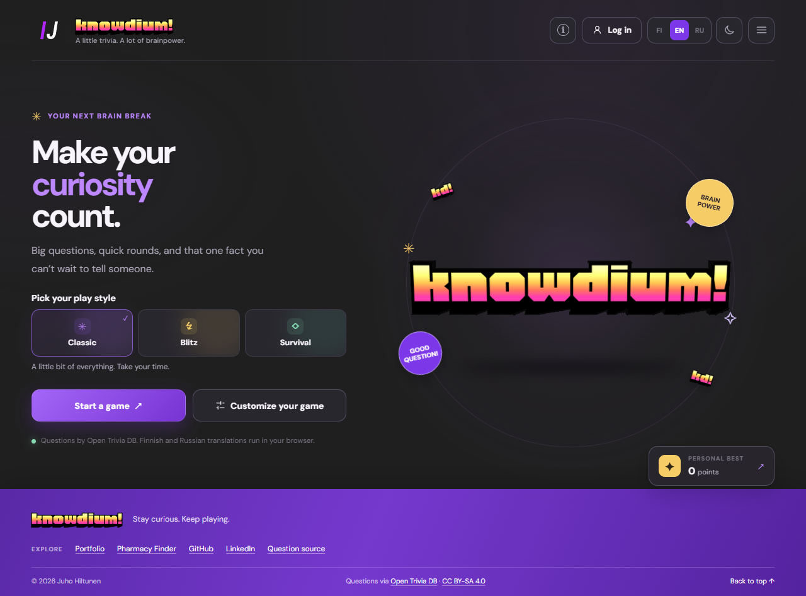

# knowdium!

A multilingual trivia game built with React and [The Trivia API](https://the-trivia-api.com/).

**[Play the live demo](https://hiltunenjuho.github.io/knowdium/)**



Choose Classic, Blitz, or Survival and customize the question count, one or more broad categories, and difficulty. Scores and the personal best are tracked during play; the personal best is saved in browser storage. The category picker defaults to a mix of all categories.

Classic has no time limit by default; an optional per-question limit can be selected in settings for the next game. In untimed Classic, questions with a supplied hint can reveal it before answering. Blitz and Survival keep their 12- and 15-second limits. Correct answers earn difficulty and streak points, with an additional speed bonus only when a timer is active.

Survival divides the selected question count into easy, medium, and hard stages, in that order. Its difficulty is automatic. If a stage has too few questions for the selected categories, choose fewer questions or more categories.

The interface defaults to the browser's Finnish, English, or Russian language; other languages default to English. The theme follows the device preference until manually changed. Language, theme, and personal-best selections are saved in browser storage. The game is playable without an account; the Log in control is currently a placeholder that says accounts are coming, and scores are not synced across devices.

## Questions and translations

Questions come from [The Trivia API](https://the-trivia-api.com/docs/), which requires no API key for its free non-commercial question endpoint. Requests fetch a batch of up to 50 at a time; The Trivia API limits keyless clients to 20 requests per 5 seconds. The app excludes questions marked as niche and requests family-friendly content. A network connection is required.

The category picker uses the API's ten broad categories, with Finnish and Russian labels provided by the app. It supports selecting several categories at once; no selection means all categories.

The original questions are in English. When Finnish or Russian is selected, questions, hints, categories, and answers are translated on the device in a Web Worker using the neural AI translation models in [Transformers.js](https://huggingface.co/docs/transformers.js): quantized [English–Finnish](https://huggingface.co/Xenova/opus-mt-en-fi) or [English–Russian](https://huggingface.co/Xenova/opus-mt-en-ru), based on Helsinki-NLP's OPUS-MT models. This is free, does not require an API key, and keeps question text on the device; there is no per-translation API quota.

Finnish and Russian translations are currently in beta. A brief notice is shown in the app only when Finnish or Russian is selected. The first use downloads about 115 MB per language from Hugging Face; subsequent use can reuse the browser's model cache, subject to browser storage policies. Download availability, network access, device memory and processing speed can still limit use. Machine translations can be inaccurate, especially for names and trivia-specific terms; the original question can be opened beneath its translation. Quoted text and SQL answer keywords are preserved where possible. The next question is translated in the background when possible, and the timer pauses if a translation is still loading.

## Run locally

The hero uses transparent WebM clips and a poster from `public/hero-videos`. Its MP4 fallback stores colour and alpha side by side and is composited with WebGL; if playback or rendering fails, the poster remains visible. Clips play at 1.5x speed with a subtle softening filter to smooth their edges. The animation respects the device's reduced-motion preference and pauses while the tab is hidden.

Requires Node.js and npm:

```bash
npm ci
npm run dev
```

Create and preview a production build:

```bash
npm run build
npm run preview
```

Run the linter:

```bash
npm run lint
```

## Deployment

The GitHub Actions workflow builds the app with Node.js 22 and publishes `dist` to GitHub Pages on pushes to `main`. The Vite base path is `/knowdium/`.
